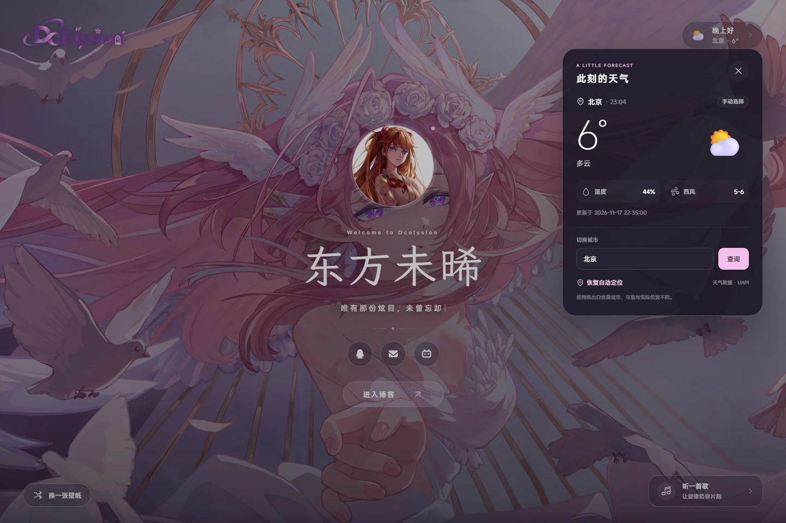
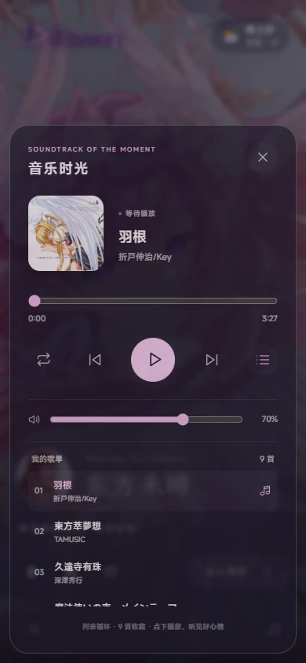

<div align="center">


# DcElysion Home

**The personal homepage of 东方未晞 (Darcy) · "Only that dazzling light, never forgotten"**

A doorway to the blog and daily footprints — or a quiet corner to change the scenery and listen to a song.

[Visit the site](https://dcelysion.cn/) · [Read the blog](https://blog.dcelysion.cn/) (Chinese) · [Development guide](docs/development.md) (Chinese) · [简体中文](README.md) / **English**


[](LICENSE)

</div>


*Full-screen animated wallpaper and profile card on first visit*

---

## More than a signpost

Most people click into a personal homepage just to grab a link to a blog or social profile.

When building **DcElysion Home**, I wanted it to feel like more than a cold signpost. Before you follow the card to the blog, Bilibili, or reach out via QQ and email, it's a place where you can linger for a few minutes — watch the time-aware greeting over an animated wallpaper, check the weather outside, or let a track from the playlist play through.

## Quiet company: wallpaper, music, and the moment

The page opens onto a full-screen animated wallpaper. Whenever you feel like a change of mood, a single click picks a new scene at random from the landscape or portrait gallery.

Music stays silent by default — nothing auto-plays to startle you when the page loads. Only when you open the playlist and pick a song does it begin playing gently in the background, and collapsing the panel won't interrupt it while you look around. Whether you prefer repeat-one, shuffle, or a particular volume level, the player remembers your choice for next time.


*Collapse the panel after picking a track and the music keeps playing in the background*

The weather panel follows the same unobtrusive philosophy. It estimates your city from your network's public IP without ever asking for precise device location permissions. You can also look up the sky and wind in another city manually, while the homepage clock and greeting stay anchored to your device's local time.


*IP-estimated local weather with no location prompt, plus manual lookup for distant cities*

On a phone, the homepage switches to wallpapers curated for portrait screens. Tap the music button at the bottom and the playlist slides up smoothly; fold it away and your focus returns to the profile card.

<p align="center">
  
  &nbsp;&nbsp;
  
</p>
<p align="center"><em>Portrait-curated wallpapers and bottom-drawer playlist on mobile (captured from the live site on 2026-11-17)</em></p>

---

## Restraint and engineering details under the hood

Despite featuring animated wallpapers, audio, and CJK web fonts, the site is built to stay light and resilient:

- **Pure static architecture** — Astro builds the shell and Svelte powers the interactive panels. There is no database, login system, or custom backend, and day-to-day maintenance is completely decoupled from the blog repository.
- **On-demand loading & Data Saver awareness** — The music module is fetched only during idle time or when you first open the playlist. Fonts are split by Unicode range, and media prefetching respects page visibility and browser Data Saver preferences.
- **Graceful under poor networks** — If an animated wallpaper cannot play, it falls back cleanly to a static poster; if a weather request times out, the last valid cache is kept with a retry option without blocking anything else. For the blog link, candidate routes are probed quietly in the background — falling back to the default URL on failure without ever forcing an automatic redirect.
- **Keyboard and motion friendly** — All pop-up panels support `Esc` to close, focus restoration, and `Tab` focus trapping, while animations step back automatically when `prefers-reduced-motion` is enabled.

### How light is the first load?

Core first-screen code (HTML + CSS + JS) weighs just **~46 KB** (gzip), paired with on-demand font subsets for a near-instant cold start:

| Resource | Transfer size (gzip) | Notes |
| :--- | :--- | :--- |
| **HTML** | ~6 KB | Single static page output |
| **JavaScript** | ~31 KB | Svelte runtime + homepage components |
| **CSS** | ~9 KB | Global styles |
| **Music module** | ~2 KB | Requested only on post-load idle or when the playlist is first opened |
| **Fonts** | ~117 KB | MiSans common subset (112 KB) + LXGW WenKai subset (5 KB); full MiSans is 8.93 MiB across 46 slices, downloaded only as needed |

<sub>*Note: Measured from a local `pnpm build` on 2026-11-19 (gzip estimate), excluding images and video streams (wallpapers, avatar, logo).*</sub>

---

## Run locally

Requires **Node.js ≥ 22.23.0** and Corepack, with the package manager pinned to **pnpm 11.22.0**.

```sh
git clone https://github.com/Darcy-1024/dcelysion-home.git
cd dcelysion-home
corepack pnpm install --frozen-lockfile
corepack pnpm dev --port 4322
```

Open [http://localhost:4322/](http://localhost:4322/) in your browser. Common development commands:

| Command | Purpose |
| :--- | :--- |
| `corepack pnpm check` | Run Astro and TypeScript type checks |
| `corepack pnpm test` | Run unit tests for weather, music, media, and blog route probing |
| `corepack pnpm build` | Build production static files into `dist/` |
| `corepack pnpm preview --port 4323` | Preview the production build locally |

### Project structure

```text
dcelysion-home/
├─ src/
│  ├─ pages/index.astro        # Page entry and <head> metadata
│  ├─ components/
│  │  ├─ Home.svelte           # Core UI & interactions: wallpaper, profile card, weather & music panels
│  │  ├─ AlbumCover.svelte     # Album art with placeholder fallback
│  │  └─ Icon.svelte           # SVG icons
│  ├─ lib/                     # Weather, music, media, greeting, blog routing logic (with *.test.ts)
│  ├─ data/home.json           # ← Profile, social links, wallpapers, and playlist live here
│  └─ styles/                  # Global styles; misans.css is generated by the font splitter
├─ public/assets/              # Wallpapers, avatar, fonts, brand images (NOT covered by MIT license)
├─ scripts/                    # Blog profile sync, font splitting, and browser regression scripts
├─ resources/fonts/            # MiSans source font (not shipped in production build)
└─ docs/                       # Development guide, asset notes, screenshots, and history (Chinese)
```

---

## Make it your own

If you'd like to adapt this repository for your own homepage, you only need to touch a few places:

1. **Profile and media lists** — Edit [`src/data/home.json`](src/data/home.json) to update the display name, bio, avatar, social links, blog candidate URLs, wallpapers, and playlist.
2. **Site domain and deployment config** — Update the site URL in [`astro.config.mjs`](astro.config.mjs) and the Cloudflare Worker name and custom domains in [`wrangler.jsonc`](wrangler.jsonc).
3. **Brand assets and font subset** — Replace personal brand images, filing info, and media files under `public/assets/`. Because the display name uses a custom subset of LXGW WenKai, regenerate the subset per the [font maintenance notes](docs/development.md#字体与验收维护) if you change those characters.

### Deploy

The static output in `dist/` can be hosted on any static platform. This project deploys via Cloudflare Workers static assets (Git push and production deployment are separate steps):

```sh
corepack pnpm exec wrangler login
corepack pnpm deploy
```

---

## Data, assets, and license boundaries

Weather data is fetched directly by the visitor's browser from a third-party service; automatic city detection is estimated solely from the network's public IP without requesting device location permissions. Audio, album art, and animated wallpapers are loaded from the configured media domains. The email address is Base64-encoded only for front-end display obfuscation, not encryption.

> [!IMPORTANT]
> **Source code** is released under the [MIT License](LICENSE) — you are free to use, modify, and distribute the code itself.
> **Repository assets are NOT covered by the MIT License**: MiSans and LXGW WenKai follow their respective bundled font licenses; the avatar, logo, wallpapers, music, and other third-party materials belong to their respective rightsholders. A public repository does not grant permission to redistribute or commercially use these assets. Please replace them with materials you have the right to publish when forking or reusing. See [ASSETS.md](docs/ASSETS.md) (Chinese) for details.
